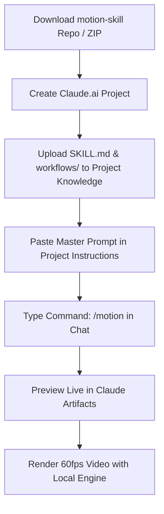

# Motion Skill: AI Motion Graphics, B-Roll & SAM 2 Video Rotoscoping for Claude 🎬✨

[](https://github.com/mrrajrumel)
[](https://github.com/mrrajrumel/motion-skill)
[](https://claude.ai)
[](LICENSE)

> **Motion** is a community-built Claude agent skill that turns talking-head videos into **motion graphics B-roll** timed to spoken words, creates **standalone 60fps motion graphic explainer videos**, and **isolates subjects** (people, products, hands) from video backgrounds using **Meta's SAM 2** — running 100% locally on your machine.

Designed specifically for **Claude.ai** (Web Projects & Artifacts), **Claude Code** (Anthropic's terminal CLI agent), **Claude Desktop**, and compatible with agentic coding environments like **Google Antigravity**.

Created by **[Rumel Ahmed](https://github.com/mrrajrumel)** · [https://github.com/mrrajrumel/motion-skill](https://github.com/mrrajrumel/motion-skill)

---

**Keywords:** Claude skills, Claude.ai motion graphics, Claude Code skills, AI B-roll generator, motion graphics automation, standalone explainer video, video object segmentation, SAM 2 video masking, rotoscoping with AI, automatic video cutaways, animated overlays, talking-head video editing, YouTube video editing automation, Antigravity skills, SKILL.md.

---

## Table of Contents

- [What can you do with the Motion skill?](#what-can-you-do-with-the-motion-skill)
- [Workflow 1: AI Motion Graphics & B-Roll](#workflow-1-ai-motion-graphics--b-roll)
- [Workflow 2: Video Object Separation (Rotoscoping with SAM 2)](#workflow-2-video-object-separation-rotoscoping-with-sam-2)
- [Requirements](#requirements)
- [Installation Guide](#installation-guide)
  - [Option A: Direct 1-Click Upload to Claude.ai (Web Projects)](#option-a-direct-1-click-upload-to-claudeai-web-projects)
  - [Option B: Install into Claude Code (Terminal CLI)](#option-b-install-into-claude-code-terminal-cli)
  - [Option C: Install into Google Antigravity](#option-c-install-into-google-antigravity)
- [How to command Claude (Prompt & Slash Commands)](#how-to-command-claude-prompt--slash-commands)
- [Project structure](#project-structure)
- [Output files](#output-files)
- [FAQ](#faq)
- [License & credits](#license--credits)
- [GitHub repository settings (About & SEO)](#github-repository-settings-about--seo)

---

## What can you do with the Motion skill?

| You want to... | Workflow | Result |
|---|---|---|
| Create standalone 60fps explainer, SaaS UI demo, or promotional motion videos from a script | **Standalone Motion Video** | Continuous single-shape morphing animation clips rendered with 4x subframe motion blur |
| Add animated cutaways, overlays or panels to a talking-head video | **B-roll** | Motion-graphic clips timed to spoken words, plus a preview video and comparison page |
| Cut a person, product or hand out of a video background | **Object separation** | Green-highlighted video plus a lossless mask PNG for every single frame |
| Separate a product, then build B-roll around it | **Both** | Separation runs first; B-roll reuses the saved masks without rerunning |

---

## Workflow 1: AI Motion Graphics & B-Roll

Generate **continuous, one-shape motion-graphic clips** with Claude. Each clip is a single shape that never cuts: it morphs its size, corners and colour between states while its content swaps with a short blur. A cursor drives the changes with real clicks and drags, and every change lands on a spoken word or beat.

### Two Supported Modes:
1. **Standalone Motion Video Mode**: Generates a complete 60fps motion graphic explainer (product highlights, kinetic UI cards, terminal demos) directly from your prompt or script without needing raw video footage!
2. **Video B-Roll Mode**: Synchronized to an existing talking-head video (`source.mp4`) and transcript (`transcript.srt`). Produces full-frame cutaways or transparent ProRes 4444 (`.mov`) overlay panels for Picture-in-Picture layouts.

### How it works:
1. **Setup** – Checks Node, Python 3 and ffmpeg; installs Playwright + Chromium locally into `motion/node_modules`.
2. **Interview** – Claude asks for your video/script, transcript (SRT/VTT), density (light / medium / heavy) and look (default palette or your brand).
3. **Inspect footage** – Reads resolution, fps and layout (full-frame speaker or picture-in-picture).
4. **Plan** – Claude presents a clip-by-clip table (timing, covered line, treatment, reason). **Nothing is built until you approve it.**
5. **Build** – Claude writes each clip as self-contained HTML following `reference/engine-api.md`.
6. **Check** – Renders still frames on key words with `engine/beats.js` and fixes layout problems.
7. **Render** – Frame-by-frame 4x subframe render with motion blur to MP4 (or ProRes 4444 `.mov` with alpha for transparent panels).
8. **Deliver** – Clips, `TIMING.md`, `preview.mp4`, `viewer.html`, `compare.html`.

**Design defaults:** Warm gray canvas `#E9E7E2`, ink `#0B0B0B`, one orange accent `#FF5A1F`, Geist and Geist Mono fonts. Your brand colours and fonts override these. No invented numbers, quotes or results.

---

## Workflow 2: Video Object Separation (Rotoscoping with SAM 2)

Isolate one subject from the background of a video using **SAM 2.1 (Segment Anything Model 2)**. Everything runs on your computer and nothing is uploaded to external clouds.

The skill scans your hardware and picks the right model automatically:

| Machine | Model | Download size |
|---|---|---|
| NVIDIA GPU with 12 GB+ VRAM | `sam2.1-hiera-large` | ~898 MB |
| NVIDIA GPU under 12 GB, or Apple Silicon | `sam2.1-hiera-base-plus` | ~323 MB |
| CPU only | `sam2.1-hiera-tiny` | ~156 MB |

> CPU-only runs work but are slow (about 5 seconds per frame). For long clips without a GPU, separate only the section you need.

**Output:** `work/separated.mp4` (subject highlighted in green edge glow) and `work/masks/subject/` (one mask per frame, white = subject).

---

## Requirements

- **Python 3.10+** (with `numpy`)
- **ffmpeg** (with `prores_ks` encoder if you want transparent panel clips)
- **Node.js 18+** (for Playwright rendering engine)
- Internet only for the first run (model and Playwright downloads)
- *Optional:* NVIDIA GPU (CUDA) or Apple Silicon (MPS) for accelerated SAM 2 object separation

---

## Installation Guide



### Option A: Direct 1-Click Upload to Claude.ai (Web Projects)

Anyone can directly upload this skill to **Claude.ai** in under 60 seconds:

#### 1. Download or Package the Skill Bundle
Clone the repository, or run the included packaging utility to create a clean zip:
```bash
git clone https://github.com/mrrajrumel/motion-skill.git
cd motion-skill
python scripts/package_skill.py
```
*(This generates `motion-skill-claude.zip` in your project folder)*.

#### 2. Create a Project on Claude.ai
1. Go to [Claude.ai](https://claude.ai) and sign in.
2. In the left navigation, click **Projects** → **Create Project**.
3. Name your project: `Motion Graphics Studio`.

#### 3. Upload Project Knowledge
Under **Project Knowledge**, click **Add Content** and upload:
- `motion-skill-claude.zip` *(or upload `SKILL.md`, `workflows/`, and `reference/engine-api.md` directly)*.

#### 4. Add Project Custom Instructions
In the Project's **Custom Instructions** box, paste:

```markdown
You are a senior Motion Graphics Director and Developer powered by the Motion Skill toolkit created by Rumel Ahmed (https://github.com/mrrajrumel).

Capabilities:
1. STANDALONE MOTION VIDEOS: Creating 60fps explainer videos, SaaS demos, and UI animations from a script, prompt, or outline.
2. VIDEO B-ROLL: Creating speech-timed cutaways and transparent PiP overlay panels for talking-head videos.
3. LOCAL OBJECT SEPARATION: Isolating subjects with SAM 2.

Commands & Prompts:
- /motion [topic or script]: Create a standalone motion graphic video.
- /motion b-roll [transcript or video]: Generate synchronized B-roll cutaways.
- /motion panel [details]: Design a transparent floating overlay panel for PiP.
- /motion separate [clip]: Isolate subject with SAM 2.

Follow the motion principles strictly:
- One continuous shape that never cuts (morphs size, corners, and color).
- Realistic cursor with human easing and clicks driving all changes.
- Content swaps with subtle blur-in/blur-out timing.
- Geist & Geist Mono typography, clean aesthetic (#E9E7E2 canvas, #0B0B0B ink, #FF5A1F accent).
- Provide live, interactive HTML preview fragments via Claude Artifacts.
```

#### 5. Chat & Preview in Claude Artifacts
Now simply start a chat in your project and give commands with `/motion`! Claude will generate interactive HTML fragments inside **Claude Artifacts** so you can preview animations directly inside your browser.

---

### Option B: Install into Claude Code (Terminal CLI)

If you use Anthropic's **Claude Code** terminal agent:

#### 1. Install as a Claude Skill
```bash
# Global installation:
git clone https://github.com/mrrajrumel/motion-skill.git ~/.claude/skills/motion

# Or project-specific installation:
git clone https://github.com/mrrajrumel/motion-skill.git .claude/skills/motion
```

#### 2. Run Setup Once
The repository includes setup scripts for all platforms:
```bash
# macOS / Linux:
bash ~/.claude/skills/motion/scripts/setup.sh ./motion

# Windows (PowerShell):
powershell -ExecutionPolicy Bypass -File ~/.claude/skills/motion/scripts/setup.ps1 ./motion
```

#### 3. Run Claude Code
```bash
claude
```
Then invoke the skill with `/motion`!

---

### Option C: Install into Google Antigravity

Because Google Antigravity natively loads skills following the `SKILL.md` specification, you can also use Motion in Antigravity:

```bash
# Clone the repository
git clone https://github.com/mrrajrumel/motion-skill.git

# Project workspace (recommended):
mkdir -p .agent/skills
cp -r motion-skill .agent/skills/motion

# Or global Antigravity skills:
# Windows: C:\Users\<user>\.gemini\config\skills\motion\
# macOS/Linux: ~/.gemini/config/skills/motion/
```
Restart or refresh your agent session, and Antigravity will detect and use the skill.

---

## How to command Claude (Prompt & Slash Commands)

> 💡 **Important Note on Slash Commands**:  
> In **Claude Code**, `/motion` is the registered skill command. Shorthand phrases like `/broll`, `/panel`, or `/separate` are prompt conventions for Claude.ai Projects. When using Claude Code in your terminal, always use `/motion` followed by your request.

### 1. Standalone Motion Videos (`/motion`)

```
/motion Create a 20-second 60fps standalone motion graphic video explaining our new developer API:
- Scene 1: An API key pill morphs into an interactive authorization card.
- Scene 2: Terminal typing showing curl request and instant JSON response.
- Scene 3: Analytics latency bar springing down from 250ms to 8ms.
```

```
/motion Create a standalone product changelog video for version 2.0. No source video needed. Use 16:9 1920x1080 resolution.
```

### 2. Video B-Roll & Cutaways (`/motion b-roll`)

```
/motion Make motion-graphic B-roll for my video at ./videos/intro.mp4.
The transcript is ./videos/intro.srt. Use medium density and my brand
colours: background #101010, accent #00C2FF.
```

```
/motion Add animated cutaways to my YouTube video at work/source.mp4.
Light density, only the strongest moments. Keep the first 5 seconds on my face.
```

### 3. Transparent Overlay Panels (`/motion panel`)

```
/motion Create a transparent floating overlay panel for the picture-in-picture
section of my video, from 0:20 to 0:45. Show an animated status island and metrics chart.
```

### 4. SAM 2 Object Separation (`/motion separate`)

```
/motion Separate the product in clip.mp4 from the background.
Frames 0 to 89. The product is in the centre of the frame.
```

```
/motion Isolate the hand holding the phone in demo.mp4 and export per-frame masks.
```

### 5. Combined Workflows

```
/motion Separate the bottle from the background in ad.mp4, then build B-roll
around it using the saved masks in work/masks/subject/.
```

### Tips for Best Results:
- Always provide a **transcript (SRT or VTT)** for B-roll. Word timing drives the animation.
- State the **density** (light, medium, heavy) and your **brand colours** upfront to skip questions.
- Tell Claude which lines to **keep on your face** or which **real numbers** to show.
- For object separation, say what to **include and exclude** (e.g. "leave out my fingers").
- Review Claude's **plan table** before approving. This is the best moment to refine the edit.

---

## Project structure

```text
motion-skill/
├── SKILL.md                 # Entry point: Claude skill descriptor & command router
├── README.md                # Full documentation & setup guide
├── LICENSE                  # MIT License
├── workflows/
│   ├── broll.md             # Motion graphics B-roll & standalone video workflow
│   └── object-separation.md # SAM 2 object separation workflow
├── engine/                  # Motion engine, base.css, build.py, render.js, beats.js, fonts (Geist, OFL)
├── scripts/                 # setup.sh, setup.ps1, package_skill.py, inspect_video, words, composite, make_pages
├── templates/               # viewer.html and compare.html
├── reference/
│   └── engine-api.md        # Complete window.M engine API reference
└── examples/
    └── opus-aoe2/           # Six finished example clips (quality reference)
```

---

## Output files

All deliverables are written to `motion/out/`:

| File | Purpose |
|---|---|
| `NN-name_XmYsZZ.mp4` / `.mov` | Individual clips named by timeline in-point |
| `TIMING.md` | File, in/out time, covered line, treatment, what is illustrative |
| `preview.mp4` | Your video with the clips cut in (for review) |
| `viewer.html` | Step through the clips one by one in your browser |
| `compare.html` | Original vs preview synced comparison (side-by-side, stacked, or wipe) |

> `preview.mp4` is for review. For the final edit, drop the clips into your own video editor (Premiere, Resolve, Final Cut, CapCut) to adjust timing, add transitions and mix audio.

---

## FAQ

**What is the Motion skill?**  
A community-built agent skill (`SKILL.md` plus engine scripts) that allows Claude to automate motion-graphics videos, speech-timed B-roll, and AI-powered video object separation.

**Can I create standalone motion videos without raw footage?**  
Yes! Use the standalone motion video command (`/motion`) to generate complete 60fps explainer and promotional videos from any script or prompt.

**Does it upload my video anywhere?**  
No. B-roll rendering and SAM 2 separation both run 100% locally on your machine.

**Which editors can I use the clips in?**  
Any editor that imports MP4 or ProRes `.mov`: Premiere Pro, DaVinci Resolve, Final Cut Pro, CapCut, and others.

**Do I need a GPU?**  
Not for B-roll or motion graphics. For object separation a GPU is much faster, but CPU works with the small model.

**Can I use my own brand colours and fonts?**  
Yes. Share colours, a logo, or screenshots in Claude chat and the skill uses them instead of the defaults.

**Does it invent statistics?**  
No. It uses placeholders and labels from your transcript unless you provide real figures.

**How do I remove the object-separation setup?**  
Delete the `.object-separation` virtual environment folder and the cached models in `~/.cache/huggingface/hub/models--facebook--sam2.1-hiera-*`.

---

## License & credits

- **Creator**: Developed by **[Rumel Ahmed](https://github.com/mrrajrumel)** ([https://github.com/mrrajrumel/motion-skill](https://github.com/mrrajrumel/motion-skill)).
- **License**: [MIT License](LICENSE).
- **Fonts**: **Geist** and **Geist Mono** (SIL Open Font License, included in `engine/fonts/`).
- **Object separation**: Uses **SAM 2.1** from Meta AI via Hugging Face Transformers.
- **Rendering**: Uses **Playwright (Chromium)** and **ffmpeg**.

---

## ⚙️ GitHub repository settings (About & SEO)

To maximize discoverability, set these in the **About** section (gear ⚙️ icon on the right side of the GitHub repo page):

- **Description**:
  ```text
  Community-built AI agent skill for Claude: motion graphics B-roll generator and SAM 2 video object separation. Works with Claude.ai, Claude Code & Antigravity.
  ```
- **Website**:
  ```text
  https://github.com/mrrajrumel/motion-skill
  ```
- **Topics**:
  ```text
  claude, claude-ai, claude-code, claude-skills, ai-agent, agent-skills, antigravity, b-roll, motion-graphics, video-editing, sam2, segment-anything, rotoscoping, video-segmentation, youtube, automation, playwright, ffmpeg
  ```
