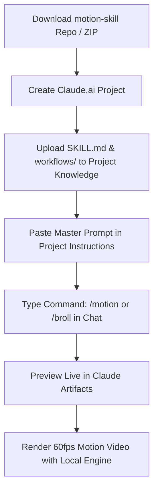

# Motion Skill for Claude 🎬✨

[](https://github.com/mrrajrumel)
[](https://github.com/mrrajrumel/motion-skill)
[](https://claude.ai)
[](LICENSE)

An intelligent, production-grade motion graphics video toolkit designed for **Claude.ai** (Web Projects & Artifacts) and **Claude Code** (Anthropic's CLI Agent).

Create **Standalone Motion Graphic Explainer Videos** and **Talking-Head Video B-Roll** (cutaways, overlays, animated panels) synchronized to speech, plus perform **100% Local AI Object Separation** with SAM 2.

> **Created by [Rumel Ahmed](https://github.com/mrrajrumel)** · [https://github.com/mrrajrumel/motion-skill](https://github.com/mrrajrumel/motion-skill)

---

## ⚡ What You Can Create

### 1. 🎞️ Standalone Motion Graphic Videos
Create complete, cinematic 60fps explainer and promotional videos from scratch—**no existing video footage needed!**
- **SaaS & Product Demos**: Feature walkthroughs, app tours, release changelogs.
- **Tech & Concept Explainers**: Architecture diagrams, workflow pipelines, code execution.
- **Social Media Reels / Shorts**: Dynamic 9:16 vertical motion cards and data visualizations.
- **Kinetic UI Animations**: Buttons, sliders, switches, drag-and-drop actions, live terminal sessions.

### 2. 🎙️ Video B-Roll & Speech-Timed Cutaways
Elevate talking-head videos into engaging, polished YouTube/course productions:
- **Full-Frame Cutaways**: Single-shape morphing scenes that explain what the speaker describes, timed to the exact syllable.
- **Transparent Overlay Panels**: Floating ProRes 4444 (`.mov`) panels placed in empty space (e.g. Picture-in-Picture).
- **Zero Awkward Cuts**: Continuous morphs where cards fluidly transform their dimensions, corners, and colors.

### 3. ✂️ Local AI Subject Separation (SAM 2)
Isolate subjects (people, products, hands, hardware) directly on your local GPU/CPU:
- 100% private: no video data uploaded to third-party clouds.
- Exports green-screen preview videos and per-frame lossless PNG alpha masks.

---

## 🚀 How to Directly Upload & Use on Claude.ai

Anyone can directly upload this skill to **Claude.ai** in under 60 seconds and start issuing commands!



### Step 1: Download or Package the Skill
Clone the repository or generate the 1-click Claude upload bundle:

```bash
# Option A: Clone the repo
git clone https://github.com/mrrajrumel/motion-skill.git

# Option B: Or package into a 1-click ZIP bundle
cd motion-skill
python scripts/package_skill.py
```
This generates `motion-skill-claude.zip` containing all instructions, workflows, and engine references.

---

### Step 2: Upload to Claude.ai Projects

1. Open [Claude.ai](https://claude.ai) and sign in.
2. In the left navigation, click **Projects** → **Create Project**.
3. Name your project: `Motion Video Studio` (or `Motion Skill`).
4. Under **Project Knowledge**, click **Add Content** and upload:
   - `SKILL.md`
   - `workflows/broll.md`
   - `workflows/object-separation.md`
   - `reference/engine-api.md`
   - *(Or upload the `motion-skill-claude.zip` bundle directly)*

---

### Step 3: Add the Master System Instructions

In your Claude Project's **Custom Instructions** box, paste the following prompt:

```markdown
You are a senior Motion Graphics Director and Developer powered by the Motion Skill toolkit created by Rumel Ahmed (https://github.com/mrrajrumel).

You support both:
1. STANDALONE MOTION VIDEOS: Creating 60fps explainer videos, SaaS demos, and UI animations from a script, prompt, or outline.
2. VIDEO B-ROLL: Creating speech-timed cutaways and transparent PiP overlay panels for talking-head videos.
3. LOCAL OBJECT SEPARATION: Isolating subjects with SAM 2.

Direct Commands Supported:
- /motion [topic or script]: Create a standalone motion graphic video.
- /broll [transcript or video]: Generate synchronized B-roll cutaways.
- /panel [details]: Design a transparent floating overlay panel for PiP.
- /separate [clip]: Isolate subject with SAM 2.

Follow the motion principles strictly:
- One continuous shape that never cuts (morphs size, corners, and color).
- Realistic cursor with human easing and clicks driving all changes.
- Content swaps with subtle blur-in/blur-out timing.
- Geist & Geist Mono typography, clean aesthetic (#E9E7E2 canvas, #0B0B0B ink, #FF5A1F accent).
- Provide live, interactive HTML preview fragments via Claude Artifacts.
```

---

### Step 4: Use Direct Commands in Chat! 💬

Now simply start a chat inside your Claude Project and give direct commands:

#### Example 1: Standalone Motion Video Command
```text
/motion Make a 25-second motion graphic video explaining our new AI code search engine:
- Intro: A search pill bar expands into an interactive terminal
- Feature 1: Cursor types "search repo" and semantic cards pop up
- Feature 2: High-speed spring slider filtering by relevance
- Outro: Call-to-action button with a smooth click pulse
```

#### Example 2: Video B-Roll Command
```text
/broll Here is my video transcript for our new release video:
"0:02 We built the fastest database ever.
 0:08 You can query 1 billion rows in 3 milliseconds.
 0:15 And deployment takes just one click."
Give me 3 motion-graphic cutaways timed to these beats.
```

#### Example 3: Transparent PiP Panel Command
```text
/panel I have talking-head footage in the right corner.
Make a transparent panel on the left showing an animated live server status island that morphs into a real-time analytics chart.
```

#### Example 4: Local Object Separation Command
```text
/separate Isolate the iPhone held by the speaker in work/source.mp4 from frame 0 to 120 so I can animate graphics floating behind it.
```

---

## 💻 Alternative: Using with Claude Code (Terminal CLI)

If you are using **Claude Code** (Anthropic's terminal CLI agent), you can run the entire pipeline end-to-end autonomously:

### 1. Install as a Claude Skill
```bash
# Global installation:
git clone https://github.com/mrrajrumel/motion-skill.git ~/.claude/skills/motion

# Or local workspace installation:
git clone https://github.com/mrrajrumel/motion-skill.git .claude/skills/motion
```

### 2. Run One-Time Setup
```bash
# macOS / Linux:
bash ~/.claude/skills/motion/scripts/setup.sh ./motion

# Windows PowerShell:
powershell -ExecutionPolicy Bypass -File ~/.claude/skills/motion/scripts/setup.ps1 ./motion
```

### 3. Run Claude Code
```bash
claude
```
Then ask:
> *"Run /motion to create an animated SaaS explainer for our product"* or  
> *"Run /broll for source.mp4 and transcript.srt"*

Claude Code will automatically inspect the video, plan the timeline, compile the HTML fragments, run contact sheet checks, and render final 60fps MP4/MOV videos with motion blur!

---

## 🎨 Motion Design Architecture

```text
               ┌──────────────────────────────────────────────┐
               │              M.scene Canvas                  │
               │          (#E9E7E2 Warm Studio Gray)          │
               │                                              │
               │   ┌──────────────────────────────────────┐   │
               │   │              #shape                  │   │
               │   │      (Single Continuous Morph)       │   │
               │   │                                      │   │
               │   │   State A  ──M.MORPH──►  State B     │   │
               │   │   [Pill]                 [Card]      │   │
               │   └──────────────────────────────────────┘   │
               │                      ▲                       │
               │                      │ Driven by             │
               │                 ┌────┴─────┐                 │
               │                 │ #cursor  │                 │
               │                 │ (clicks) │                 │
               │                 └──────────┘                 │
               └──────────────────────────────────────────────┘
```

- **Spring-Driven Physics**: Closed-form analytical spring equations (`M.track`, `M.MORPH`, `M.FAST`, `M.SLOW`).
- **Subframe Motion Blur**: Every frame renders 4 subframes across a 180° shutter blended with `ffmpeg tmix`.
- **Pure Time Functions**: `seek(t)` draws any exact microsecond with zero state drift or CSS animation desync.
- **Geist Design Tokens**: Base64-embedded Geist & Geist Mono fonts for crisp, modern typography.

---

## 🗂️ Project Layout

```text
motion-skill/
├── SKILL.md                     # Skill descriptor & command router
├── README.md                    # Documentation & Claude.ai usage guide
├── LICENSE                      # MIT License
├── workflows/
│   ├── broll.md                 # Motion graphics & B-roll workflow
│   └── object-separation.md     # Local SAM 2 video rotoscoping workflow
├── engine/
│   ├── base.css                 # Base styles & typography
│   ├── motion.js                # Core spring physics engine (window.M)
│   ├── build.py                 # Fragment to standalone HTML compiler
│   ├── render.js                # 4x subframe motion blur video renderer
│   ├── beats.js                 # Keyframe still contact sheet extractor
│   └── fonts/                   # Embedded Geist & Geist Mono fonts
├── scripts/
│   ├── setup.sh                 # Linux/macOS setup script
│   ├── setup.ps1                # Windows PowerShell setup script
│   ├── package_skill.py         # 1-click Claude.ai ZIP packaging tool
│   ├── inspect_video.py         # Video resolution, fps & PiP detector
│   ├── words.py                 # SRT transcript word timestamp parser
│   ├── composite.py             # Automatic preview composite generator
│   └── make_pages.py            # Generates viewer.html and compare.html
├── templates/
│   ├── viewer.html              # Interactive clip-by-clip review player
│   └── compare.html             # Synced side-by-side comparison player
├── examples/
│   └── opus-aoe2/               # 6 production-ready clips + plan.json
└── reference/
    └── engine-api.md            # Complete window.M API reference
```

---

## ⚙️ Local Rendering Command Reference

After Claude generates your clip fragments in `motion/clips/`:

```bash
# 1. Compile HTML fragments
python engine/build.py motion/dist motion/clips/*.html

# 2. Check stills on key beats
NODE_PATH=./motion/node_modules node engine/beats.js motion/dist/01-clip.html motion/work/sheet.png 0.5 1.2 2.4

# 3. Render 60fps MP4 (or ProRes 4444 .mov for alpha panels)
NODE_PATH=./motion/node_modules node engine/render.js motion/dist/01-clip.html motion/out/01-clip.mp4 60

# 4. Generate composite and review pages
python scripts/composite.py motion/plan.json motion/out/preview.mp4
python scripts/make_pages.py motion/plan.json motion/out/preview.mp4
```

---

## 👤 Creator & Author

**Rumel Ahmed**
- **GitHub**: [@mrrajrumel](https://github.com/mrrajrumel)
- **Repository**: [https://github.com/mrrajrumel/motion-skill](https://github.com/mrrajrumel/motion-skill)

---

## 📄 License

This project is licensed under the [MIT License](LICENSE).  
Embedded Geist fonts are licensed under the [SIL Open Font License 1.1](engine/fonts/OFL-Geist.txt).
